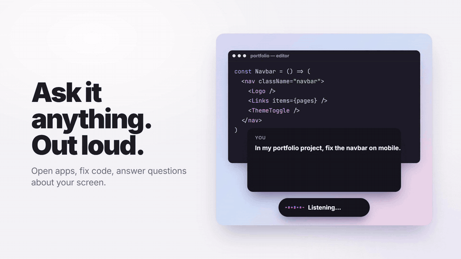

<div align="center">

# Nova

**Talk to your computer. It does the work.**

Say "Hey Nova" and ask for anything: open apps, fix code, answer questions about your screen, or type for you in any app.<br>
Free and open source. No account, no subscription, no Nova server. Speech recognition runs on your computer.

[](https://github.com/AyushM1701/nova/releases/latest)
[](#install)
[](LICENSE)

**[Download for Windows](https://github.com/AyushM1701/nova/releases/latest/download/nova-main.zip)** · **[Install on Mac](#install)** · [What it can do](#everything-it-does) · [Is it safe?](#safety)

<a href="docs/media/nova-hero.mp4"></a>

<sub>▶ [Watch the 1-minute demo, with sound](docs/media/nova-hero.mp4) · [Setup walkthrough](docs/media/nova-setup.mp4)</sub>

</div>

## Three things you'll use every day

**🗣️ Ask it anything, out loud.** "Open Spotify and play something chill." "In my portfolio project, fix the navbar on mobile." "What's this error on my screen?" Nova sends the request to **Claude Code** or **OpenAI Codex** (the Claude or ChatGPT plan you already have) and answers out loud. It sees the app you're in, remembers what you tell it, and you can talk over it to change direction.

**⌨️ Dictate into any app.** Hold Left Ctrl (Left Cmd on a Mac) and talk. Clean text appears wherever your cursor is: Gmail, Slack, VS Code, WhatsApp, a terminal. Nova removes "um" and "uh", applies "no wait" corrections, writes Hindi and Hinglish in English letters, and learns your names and jargon. Dictation works with no AI connected at all.

**📝 Record meetings without a bot.** "Record this meeting." Nova captures your mic and your computer's audio, transcribes it on your computer, labels who spoke and, with an AI connected, writes the minutes. Nobody in the call sees a bot join.

## Why Nova

| | **Nova** | OpenWhispr | HeyClicky |
|---|---|---|---|
| Price | **Free** (the assistant uses your Claude or ChatGPT plan) | Free tier with 2,000 cloud words/week; Pro $80/year | Free tier with 25 talk messages/month; Pro $20/month |
| Open source | **Yes, MIT** | Yes, MIT | No |
| Account needed | **No** | Only for cloud features | Yes |
| Speech recognized on your computer | **Yes, by default** | Yes, with local models | No, everything goes to the cloud |
| Hands-free "Hey Nova" | **Yes** | Hotkey | Hotkey |
| Works in your code projects | **Yes, through Claude Code or Codex** | No | No |
| Asks before risky commands | **Yes, every command goes through a local guard** | n/a | Asks before deletes, emails and payments |
| Meetings without a bot | **Yes** | Yes | No |
| Use it from your phone | **Yes, free** | iPhone app (sync needs Pro) | No |
| Hindi and Hinglish | **Yes** | Hindi | Not listed |

<sub>Competitor details come from openwhispr.com and heyclicky.com as of October 2026.</sub>

## Everything it does

- **Assistant mode:** "Open Spotify and play something chill", "in my portfolio project, fix the navbar on mobile", "copy my resume to the clipboard", "what's the weather in Goa?"
- **Dictation mode:** filler words ("um", "uh") are removed, self-corrections are applied ("meet at 6, no wait, 7" becomes "meet at 7"), and Hindi or Hinglish is written in English letters.
- **Snippets:** say "my address" and Nova types the whole thing. Add them on the Dictionary page.
- **See your progress:** the Home page counts words dictated, your speaking speed and the minutes you saved over typing (kept on your computer).
- **Sounds right in every app:** set a tone per app (casual in WhatsApp, professional in Gmail) in Settings → Dictation.
- **Fully offline dictation:** point Nova at Ollama, llama.cpp or LM Studio in Settings → Dictation, and long dictations are tidied on your computer with no subscription.
- **Command mode:** select text in any app, press the shortcut and say "make this more formal", "translate it to Hindi" or "fix the grammar". The selection is rewritten in place.
- **Knows what you're looking at:** "what's this error on my screen?" gives the AI a screenshot to look at, and every spoken request tells it which app you're in. You can turn this off.
- **Conversational:** talk over Nova to interrupt it and redirect it; when it asks you something ("Want me to run the tests?") it listens for your answer without "Hey Nova".
- **Remembers:** tell it "remember I use pnpm" and it keeps that in `workspace/notes/memory.md` for every later request; see and delete entries on the window's Memory page. It also remembers your last 20 copies (in memory only, skipping passwords and keys), so "paste the link I copied earlier" works.
- **Point at things:** "turn this card into a Tailwind component" dims the screen so you can drag a box around what you mean; other questions about your screen send just the window you're in. Highlight code and ask "where else is this function called?" and Nova passes the selection along.
- **Walks you through it:** "walk me through exporting this as a PDF" and Nova's arrow shows each click on your screen, moving on after you click. Esc stops it.
- **Routines:** "start my day" gives a short spoken rundown (each project's branch and uncommitted changes, open tasks in your notes, follow-ups from memory). Add your own in Settings → Routines, e.g. "deep code mode" = "pause music, open VS Code in portfolio, run npm run dev". Schedule them by voice: "every weekday at 9, run start my day".
- **Keeps an eye on long jobs:** run `python <nova folder>/helpers/watch.py npm run build` and keep working; Nova says when it's done, or explains why it failed and offers to fix it. Turn on Settings → AI → "Tell me when Claude Code finishes" to hear when a Claude Code task you started in a terminal is done.
- **Notices your meetings (Windows):** when Zoom, Teams or a Google Meet tab starts using your microphone, Nova offers to take notes.
- **Listens to your computer (Windows):** say "listen to my computer" (or use the tray menu) during a video, lecture or call, then ask "what did they just say?" or "grab the command they mentioned". The transcript covers the last 15 minutes and stays in memory; "stop listening" ends it.
- **Uses your real browser (Windows):** Opera GX, Brave, Vivaldi or Opera, inside your own profile with your logins, through a small Nova extension that only talks to Nova on this computer. "Open my GitHub notifications and summarise them", "fill this form with my address", "in Brave, find the cheapest flight to Goa". Nova asks before clicks and keys that look like submitting, buying, posting or sending (it judges by the button, so a page can disguise one), and never types passwords, card numbers or one-time codes. Turn it on in Settings → Browsers (or the tray menu → Browsers…); a Nova panel in the browser shows the same live conversation, with Allow / Deny.
- **Your notes in Claude Code:** one click in Settings → AI lets Claude Code or Codex search your Nova notes, meetings and memory in any session, on your computer.
- **Never stuck at a limit:** when Claude Code or Codex reaches its usage limit, Nova can switch to a free Google Gemini key (Settings → AI → Backup brain) until it resets. Its commands go through the same safety guard. On Google's free tier your requests may be used to improve Google's products, so it's off until you add a key.
- **On your phone:** turn on Settings → Phone and scan the code with your iPhone or Android phone. You get the same live conversation: type or dictate requests, see replies, and **Allow / Deny** from the couch. Add it to your home screen and it opens like an app. Works on home Wi-Fi, and from anywhere with Tailscale (see [Phone](#phone)).
- **The Nova window:** click the tray icon (in the hidden icons area, the ^ next to the clock; in the menu bar on a Mac). It has a chat for typed requests, your history, your dictionary and every setting. You can also ask Nova to change itself: "use Ctrl+Shift+N as my shortcut".

## FAQ

**Is it really free?** Yes. Nova is MIT-licensed, with no paid tier, no account and no server. The assistant runs on Claude Code or Codex, so it uses the Claude or ChatGPT plan you already have. Dictation, meeting transcription, "Hey Nova" and the instant commands (volume, timers, opening apps) need no AI subscription.

**Does my voice leave my computer?** No, not by default. Speech recognition and the wake word run on your machine. Only the text of a request goes to the AI you chose. Details are in [What stays on your computer](#what-stays-on-your-computer).

**Do I need to know how to code?** No. Setup is a double-click on Windows and one pasted line on a Mac. Nova installs what it needs and asks before installing anything system-wide.

**Can an AI running commands on my computer break something?** Every command, file edit and file read goes through Nova's [guard](#safety) first. Deleting files, `git push`, installing software and sending data ask you first. Wiping disks and reading saved passwords are always blocked.

**Does it work offline?** Dictation, "Hey Nova", meeting transcription and spoken replies do. Assistant requests need the internet, because Claude Code and Codex run in the cloud.

**Which languages?** Whisper recognizes about 100 languages. Hindi and Hinglish are tuned in particular and come out in English letters.

## Install

You need about 3 GB of free space and an internet connection for the first setup. Setup installs everything else it needs and asks before installing anything system-wide. You don't need git or a terminal.

Prefer to watch? The [one-minute setup walkthrough](docs/media/nova-setup.mp4) shows every step on Windows.

### Step-by-step (no git needed)

**Windows 10/11**

1. On the [latest release](https://github.com/AyushM1701/nova/releases/latest), download **`nova-main.zip`** (under *Assets*).
2. Right-click the downloaded `nova-main.zip` → **Extract All…** and pick a folder you'll keep, for example `Documents\nova`. Nova runs from this folder, so don't delete it afterwards.
3. Open the folder and double-click **`setup.cmd`**. If Windows shows "Windows protected your PC" or a security warning, click **More info → Run anyway** (or **Run**).
4. A Nova setup window shows each step. The first run downloads about 1 GB and takes a few minutes; Nova then fetches its Hindi/Hinglish speech model (1.6 GB) in the background while you already use it. If Python 3.11–3.13 isn't installed, setup offers to install it for you.
5. When it says "Nova is installed", Nova opens its first-run screens (microphone, AI, shortcut). See [First run](#first-run) below.

**macOS 12+ (Apple Silicon or Intel)**

1. Open **Terminal** (press Cmd+Space, type "Terminal", press Enter).
2. Paste this line and press Enter. It downloads Nova into a `nova-main` folder in your home folder and starts setup:

   ```bash
   cd ~ && curl -fsSL https://github.com/AyushM1701/nova/releases/latest/download/nova-main.tar.gz | tar xz && cd nova-main && bash setup.sh
   ```

3. If Python 3.11–3.13 with Tk isn't installed, setup offers to install it with Homebrew, or tells you to get it from [python.org](https://www.python.org/downloads/macos/) and run the same line again.
4. A Nova setup window shows the rest of the progress, then opens Nova from `~/Applications/Nova.app`. Nova runs from `~/nova-main`, so keep that folder.

Prefer a ZIP? Download **`nova-main.zip`** from the [latest release](https://github.com/AyushM1701/nova/releases/latest), unpack it, and double-click **`setup.command`**. Because it was downloaded, macOS blocks it the first time ("Apple could not verify…"): click **Done**, open **System Settings → Privacy & Security**, scroll down to *"setup.command" was blocked*, click **Open Anyway**, enter your password and click **Open**. (On macOS 14 and earlier, right-click → **Open** does the same.)

If you use git, `git clone https://github.com/AyushM1701/nova.git`, then run `setup.cmd` (Windows) or `./setup.sh` (Mac) in the folder; `git pull` and running setup again updates Nova.

Setup:

1. Finds or installs Python 3.11–3.13 (it asks before installing anything).
2. Creates Nova's own Python environment inside the folder and installs its libraries.
3. Downloads the fast speech model (about 470 MB, once), plus GPU support if you have an NVIDIA card. The accurate model for Hindi and Hinglish (1.6 GB) downloads in the background the first time Nova runs.
4. Adds Nova to the Start menu or `~/Applications`, runs Nova's self-checks and starts it.

### First run

Nova then shows its own first-run screens:

1. **Microphone:** a live level meter shows that Nova hears you.
2. **Brain:** pick **Claude Code** or **Codex**. If it isn't installed, one click installs it (and Node.js if needed); **Sign in** opens its login (your Claude or ChatGPT account). Skip it and dictation still works.
3. **Shortcut:** keep Ctrl+Alt+Space or press a new one, and turn "Hey Nova" on or off.
4. **Start at login**, and a first try.
5. **A 2-minute walkthrough:** a short video for each thing Nova does (talking, dictation, rewriting a selection, questions about your screen, approvals), each followed by a "your turn" step that waits until you've really tried it. Skip any step, or take it again from Home. The clips (about 1.5 MB) download the first time it opens and are checked against the release's checksum.

**On a Mac**, the last screen lists the permissions Nova uses (Microphone, Input Monitoring, Accessibility, Screen Recording) and shows which ones macOS allows right now. **Allow** shows macOS's own prompt the first time and opens that page of System Settings → Privacy & Security after that; the row turns to *Allowed* as soon as you switch Nova on. Then click **Restart Nova** (macOS applies some of these only to a fresh start). If Nova isn't in a list, **Show Nova in Finder** and drag it in. Screen Recording is only needed for questions about your screen, and Nova asks for it the first time. The same list is at the top of Settings → General, and if a permission is turned off later, Nova says so when it starts.

**Try it:** press the shortcut (or say "Hey Nova") and say "what time is it?". Then try "open YouTube", and, with an AI connected, "what's the weather in Goa?".

### Updating

Nova checks GitHub once a day. When a new version is out, it says so, and the Nova window's Home page shows an **Update** button: one click downloads the new release, checks it against the release's published SHA-256 checksum (a download that doesn't match is refused), reruns setup (which runs the self-checks) and restarts Nova. Your settings, history, notes, memory and speech models are kept. You can also click **Check now** in Settings → Advanced, or turn the daily check off there.

Only tagged releases reach the Update button, never unreleased work on `main`. To update by hand instead: download the new release's ZIP into the same folder and run setup again, or `git pull` and run setup. On a Mac installed with the Terminal line, run the same line again. To see the first-run screens again, use Settings → Advanced → Run setup. Uninstall with `uninstall.cmd` (Windows) or `./uninstall.sh` (Mac).

## Using it

| Do this | What happens |
|---|---|
| Say "Hey Nova", press **Ctrl+Alt+Space** (Mac: **Cmd+Shift+Space**), or click the bar | Nova listens. Press again to stop early, or press while it's working to cancel. |
| "Hey Nova, play some music" in one breath | Runs straight away |
| Esc | Stop listening or talking; when Nova is asking for permission, Esc denies. A request Nova is working on keeps going (Esc in another app shouldn't stop it): press the shortcut again, or Stop in the Nova window or on your phone |
| "switch to dictation" / "switch to assistant" | Change mode |
| "new conversation" | Forget the follow-up context |
| "add Kubernetes to my dictionary" | Teaches the speech recognizer a word. Fixing a misheard word right after dictating teaches it too (Settings → Dictation) |
| Hold **Left Ctrl** (**Left Cmd** on a Mac) for 1.5 s (key and time set in Settings → General) | Hold-to-dictate: Nova types what you say until you let go, however long you pause. A second hold key can ask Nova instead |
| Tap **Ctrl** three times (Mac: **Cmd**) | Same as the shortcut, from any app. Ignored while a game is in front: one installed by Steam, Epic, Xbox, GOG, EA, Ubisoft or Riot, any full-screen game on Windows, or an app filed as a game on a Mac. Turn it off in Settings → General |
| "record this meeting" / "record our conversation" / "record everything we're saying" / "stop recording" | Records your microphone and the computer's audio (no bot joins), then writes a transcript with speaker labels and minutes from your notes. While it records, a card reminds you every 15 minutes. See the Meetings page, where you can also export it as subtitles (SRT) or text, or open its Markdown note. "Don't record this" or "how do I record a call?" go to the AI instead |
| Settings → General → **Teach Nova your "Hey Nova"** | If Nova often misses your "Hey Nova" (it was first tuned on American English), say it 8 times there. A second detector, trained on Indian-English "Hey Nova"s, then listens too. It needs something spoken and ignores voices from the computer's own speakers. It's new: tell us if it wakes when you didn't call it |
| "turn it up a bit", "volume 40", "skip this song", "open VS Code", "open YouTube", "what time is it?", "set a timer for 5 minutes", "lock my computer" | Done instantly on your computer: no AI call, no quota used |
| Select text, then "make this shorter" (dictation mode) | Rewrites the selection in place |
| Click the tray icon, or right-click the bar | Opens the Nova window |

**The bar** at the bottom-centre shows what Nova is doing:

- a waveform while it listens
- dots while it thinks
- a ripple while it talks
- amber when it needs your OK

Hover over it to see the shortcut. Settings → General → **Where the bar sits** moves it to the top of the screen; on a MacBook with a notch it then hangs from the notch and grows out of it while Nova listens, thinks and talks, like the Dynamic Island. Clicking the tray / menu bar icon opens the Nova window; its menu has mode, **Brain** (switch between Claude Code and Codex), pause, settings and quit.

## Phone

Use Nova from your iPhone (or any phone) while it runs on your computer. Nothing to install on the phone.

1. In the Nova window, open **Settings → Phone** and turn on **Use Nova from your phone**. On Windows, the first time, allow Python through the firewall on **private** networks when Windows asks. (If your Wi-Fi is set to "Public network", phones can't connect; switch it to Private in Windows' network settings.) On a Mac, click **Allow** if macOS asks whether Nova may accept incoming connections.
2. Make sure the phone is on the same Wi-Fi, open its **Camera**, point it at the QR code and tap the link.
3. In Safari, tap **Share → Add to Home Screen**. Nova now opens like an app.

If you added Nova to your home screen before version 1.2.2 and see a blank strip at the bottom, remove the icon and add it again (iOS keeps the old status-bar setting until then).

You pair once. The page reconnects by itself after the phone locks, leaves and rejoins the Wi-Fi, or Nova restarts. While phone access is on and the computer is plugged in, Nova keeps it from sleeping (Settings → Phone → Keep this computer awake), because a sleeping computer can't answer. If you have Tailscale, pair with its code: that address never changes, while a home Wi-Fi address can change when the router restarts (then scan again, or give the computer a fixed address in your router).

Type a request, or tap the **mic on the phone's keyboard** to dictate it. Replies, the steps Nova takes and approval requests appear live; tap **Allow** or **Deny**. The speaker button reads replies aloud. The computer has to be on with Nova running.

**Dictate from your phone into the computer:** switch the bar above the message box to **Type on computer**, tap the mic on the phone's keyboard and speak (or type), then tap send. Nova types it into whatever app is in front on the computer, cleaned up like any dictation: fillers removed, "no wait" corrections applied, Hinglish in Roman letters, your dictionary and replacements. Select text on the computer first and say "make this more formal" to rewrite it. Switch back to **Ask Nova** for requests.

**Send things from your phone to the computer:** tap the clipboard button next to the message box. Tap and hold in the box and choose **Paste** (text, or a picture or screenshot you copied), or tap **Choose photo or file**, then **Copy to computer**. It lands on the computer's clipboard: press Ctrl+V (Cmd+V on a Mac) in any app. Text also goes into Nova's clipboard history, so "paste what I copied on my phone" works; pictures paste as pictures and other files (up to 25 MB) as files. Received pictures and files are also kept in `workspace/phone/` (the newest 30).

**Siri, the Action Button, Apple Watch and CarPlay:** tap **Siri** at the top of the phone page. It gives you a link to copy and five steps to build an "Ask Nova" shortcut in the Shortcuts app (Dictate Text → URL Encode → Get Contents of URL → Speak Text). Then say "Hey Siri, Ask Nova" and your request; Siri reads Nova's answer. A task that takes longer than about 50 seconds keeps going, and its answer appears in the phone page. Siri's dictation is Apple's, not Nova's on-device speech recognition.

**Away from home:** install the free [Tailscale](https://tailscale.com/download) app on the computer and the phone, and sign in to both with the same account. Settings → Phone then shows a second code, "Anywhere, with Tailscale"; scan that one and the page works from anywhere, privately and encrypted, without opening anything to the internet.

**Safety:** only phones that scanned the code can connect; each link carries a secret pairing key. **Forget phones** in Settings → Phone makes a new key and disconnects every paired phone. On home Wi-Fi the connection isn't encrypted, so use it on your own network, not public Wi-Fi; over Tailscale it is encrypted. A paired phone can do anything you can do from the Nova window, including approving requests, so treat the link like a password.

## What stays on your computer

- **Speech recognition** (Whisper via faster-whisper, or Parakeet, Orukeet or whisper.cpp if you choose them) and the **"Hey Nova" wake word** run entirely on your machine by default. Nothing you say is kept unless it starts with "Hey Nova", you pressed the shortcut, or you spoke while Nova was talking (see below). If you teach Nova your "Hey Nova" (Settings → General), your 8 tries and a voiceprint stay in `data/` on this computer, and so do the few seconds of sound each time that detector wakes Nova (the newest 300, in `data/wakeword-shadow/`), so a wake you didn't want can be found and fixed. Delete those folders to remove them. **If you choose a cloud engine** (OpenAI, Groq, Mistral, Deepgram or your own server, in Settings → Voice), what you say to Nova is sent to that service under your own key and its privacy policy; meetings and "Hey Nova" still stay on your computer.
- **What the computer plays** (a video, a call) is remembered for the last 10 minutes on Windows, in memory, so you can ask "what did they just say?" any time. It's transcribed only when you ask (or as it plays, on a GPU). Settings → Privacy & safety changes the minutes, or 0 turns it off.
- **While Nova is talking,** it listens for you interrupting. To tell you apart from a video or call, it compares what the microphone heard with what the computer played. Those few words are written to Nova's activity log (`logs/`), which stays on this computer and is deleted after 30 days.
- **Your screen:** when a request is about it ("summarize this page", "what's on my whole screen?"), the AI gets a screenshot and the window's text, read through Windows UI Automation or macOS Accessibility, including what's scrolled out of view. Password fields are never read.
- **Meetings** are recorded and transcribed on your computer. The recording is deleted once it's transcribed; the transcript and minutes are kept as notes in `workspace/notes/meetings/`. Minutes, AI actions and questions about meetings send the meeting's text to your chosen AI. A connected calendar is only read, from its secret ICS address.
- **Spoken replies** use a neural voice run by sherpa-onnx on your own computer: Piper (the default) or Kitten (the lightest), both installed by setup, or Kokoro (the most natural, downloaded only if you pick it). Or your operating system's own voices (Windows SAPI, macOS `say`) if you prefer them or no voice is downloaded.
- **Each dictation's audio** is kept in `data/last-dictation.wav` until it's typed, then deleted, so Nova closing mid-dictation never loses it: the next start puts the words on your clipboard.
- **Settings, logs, notes and history** live in the Nova folder (`config.json`, `logs/`, `workspace/notes/`). History is kept for 30 days and can be cleared on the History page. There is no Nova server, account or analytics. The daily update check only asks GitHub which Nova release is the latest (Settings → Advanced turns it off).
- **With a local model** for dictation (Settings → Dictation), dictated text goes only to that model's address, normally on this computer.
- **Text only goes out to your chosen AI:** your request and, for long or tricky dictations, the dictated text go to Claude Code or Codex, because that's where the AI runs. With "Share what you're looking at" on (Settings → Privacy & safety), a spoken request also says which app or window you're in, and a request about your screen comes with a screenshot (saved as `workspace/screen.png`). Nova turns off Claude Code's telemetry and error reporting, and turns off the speech-model downloader's telemetry and online checks after setup.

## Safety

**In the browser**, Nova checks the real element on the page (not what the AI says it is): reading, navigating, scrolling and ordinary clicks are allowed; clicks that submit, buy, post, send or delete, pressing Enter in a form, downloads and page scripts ask you first; typing into password, card or one-time-code fields is blocked. Page text is treated as data, never as instructions.

**Permissions** (Settings → Privacy & safety, or the tray menu → Permissions) set how often Nova asks:

| Mode | What asks first |
|---|---|
| **Auto** (default) | Only risky things: deleting or moving files, installing, `git push`, closing apps, sending data, system settings, startup items, changes to Nova or to Claude Code/Codex settings, code typed straight into a command, and running a script written or changed in the last few minutes (the AI could otherwise write code to a file and run it unasked). Unfamiliar commands and ordinary files outside your projects just run. |
| **Manual** | Every change, including edits inside your projects and `git commit`. Reading, searching and opening apps don't ask. |
| **Accept edits** | Edits inside your projects run freely; anything unfamiliar asks. |
| **Plan** | Nothing changes: the AI looks around, describes its plan and asks. Say "go ahead" (or "yes") and that plan runs once with Auto's rules. |
| **Bypass permissions** | Nothing asks. Wiping disks, turning off the firewall or antivirus, reading saved passwords or SSH keys and running scripts piped from the internet stay blocked in every mode. |

**On the computer**, in Accept edits mode (the others adjust it as above):

Every command, file edit and file read that Claude Code or Codex makes passes through Nova's guard (`guard/guard.py`) first:

- **Allowed:** reading files, opening apps and websites, media, edits inside your Claude Code / Codex projects, `git status/diff/commit`, running tests.
- **Asks you first:** deleting or moving files, `git push`, installing software, closing apps, shutting down, `sudo`, system settings, uploads, starting a program with hidden arguments (`Start-Process git -ArgumentList push`), writing outside your projects, changing Nova's own settings, and anything it doesn't recognise. You see the exact command on the card and in the Nova window's chat; press the shortcut or **Allow** to allow, Esc or **Deny** to deny. No answer in 30 s means no.
- **Never:** wiping disks or system folders, disabling the firewall/Defender/SIP, changing user accounts, reading saved passwords, keychains or SSH keys, or `curl … | sh`.

If the guard fails, Nova isn't running, or the CLI skips the guard, the action is denied, or Nova warns you. Codex additionally runs in its `workspace-write` sandbox. The rules are tested by `tests.py`.

## Settings

Change them in the Nova window → **Settings** (they apply within a second, no restart), by asking Nova ("keep the reply card up for 10 seconds"), or by editing `config.json`. `config.json` only holds the values you changed; everything else comes from `config.default.json`, so new settings from an update reach you automatically.

| Setting | Default | Meaning |
|---|---|---|
| `hotkey` | Ctrl+Alt+Space / Cmd+Shift+Space | e.g. `"ctrl+shift+n"` |
| `hotkey_2` | off | A second shortcut, e.g. one for each mode |
| `hold_key` / `hold_key_2` | `left ctrl` (`left cmd` on a Mac) / off | Hold to talk: `"left ctrl"`, `"right ctrl"`, `"right alt"`, `"right shift"`, or `"ctrl"`, `"alt"`, `"shift"` (either side); on a Mac also `"left cmd"`, `"right cmd"`, `"cmd"` |
| `hold_delay_s` | `1.5` | Seconds a hold key is held on its own before Nova listens |
| `hotkey_mode`, `hotkey_2_mode`, `hold_mode`, `hold_key_2_mode`, `triple_tap_mode` | `current`, `dictation`, `dictation`, `assistant`, `assistant` | What each one starts: `"current"` (the mode Nova is in), `"assistant"` or `"dictation"` (for that request only). The same key in two slots follows the current mode |
| `wake_word` | `true` | Listen for "Hey Nova" |
| `overlay.position` | `bottom` | `"top"` puts the bar at the top of the screen (from the notch on a MacBook) |
| `voice.tts_engine` | `piper` | `"piper"`, `"kitten"`, `"kokoro"` (downloads when picked) or `"system"` |
| `voice.kokoro_voice` / `voice.kitten_voice` / `voice.tts_speed` | `af_heart` / `expr-voice-2-f` / `1.0` | Kokoro voice, e.g. `"bm_george"` (British man); Kitten voice, `expr-voice-2-m` to `expr-voice-5-f`; speed 0.75 to 1.4 |
| `voice.tts_voice` | system default | System voice name, e.g. `"Microsoft Zira Desktop"` or `"Rishi"` (Mac) |
| `voice.language` | `auto` | Or `"en"`, `"hi"`… |
| `brain.engine` | set by setup | `"claude"` or `"codex"` |
| `brain.claude_model` / `brain.codex_model` | CLI default | Model for assistant requests |
| `brain.codex_sandbox` | `workspace-write` | Use `danger-full-access` if Codex's sandbox blocks opening apps (the guard still applies) |
| `dictation.editing` | `light` | `verbatim`, `light` or `medium` |
| `dictation.dictionary` / `replacements` | | Words to spell right, e.g. `{"wisper": "Wispr"}` |
| `dictation.snippets` | | Say the phrase alone, Nova types the text, e.g. `{"my address": "221B Baker Street"}` |
| `dictation.tones` | | How to sound per app, e.g. `{"Gmail": "clear and professional"}` |
| `dictation.cleanup_engine` | `ai` | `"local"` tidies dictation with a model on this computer instead of Claude Code / Codex |
| `dictation.local_url` / `local_model` | `http://localhost:11434/v1` / `llama3.2:3b` | The local model's OpenAI-compatible address and name (Ollama's defaults) |
| `projects.aliases` | | Spoken nicknames, e.g. `{"my site": "portfolio"}` |
| `projects.folders` | `[]` | Folders where Nova creates and edits files without asking, e.g. `["D:\\projects"]` (Settings → AI). Folders holding your Claude Code / Codex projects count automatically. A drive, your user folder, Documents, system folders and Nova's own folder are refused |
| `voice.barge_in` | `true` | Talk while Nova answers to interrupt it |
| `brain.auto_model` | `true` | Quick actions use Haiku; "use opus to…" picks the model for one request |
| `brain.clipboard_history` | `true` | Remember your last 20 copies, in memory only |
| `browser.default` / `browser.enabled` | `opera-gx` / none | Which browsers Nova is set up in; say "in Brave" for one request, "add Vivaldi" / "stop using Brave" to change |
| `schedules` | `[]` | Routines run on a timetable, added by voice ("every weekday at 9, run start my day") and removed in Settings → Routines |
| `routines` | `{}` | Spoken routines, e.g. `{"deep code mode": "pause music, open VS Code in portfolio"}` |
| `brain.fallback_model` | `gemini-flash-latest` | The backup brain's Gemini model (the key itself lives in `data/fallback.key`) |
| `update_check` | `true` | Check GitHub once a day for a newer Nova |
| `safety.mode` | `auto` | `auto`, `manual`, `accept_edits`, `plan` or `bypass` (see [Safety](#safety)) |
| `meetings.detect` | `true` | Windows: offer to take notes when a meeting app starts using the microphone |
| `phone.enabled` | `false` | Serve the phone page on your network (Settings → Phone) |
| `brain.screen_context` | `true` | Tell the AI which app you're in, and send a screenshot when you ask about your screen |

## Speed

- **Windows with an NVIDIA GPU:** speech takes about 0.3 s.
- **CPU (and every Mac):** English takes 1–3 s with the `small` model; Hindi is re-transcribed with the larger model, which takes several seconds.
- **The AI step:** a request to the AI takes 5–30 s, depending on the task.

## Troubleshooting

- **The Nova window opens as a second taskbar button next to your pinned Nova (Windows):** your pin was made before version 1.2.2. Run setup again (or update), then unpin Nova and pin it again from the Start menu.
- **No icon?** On Windows, click the ^ next to the clock. Nova may already be running; only one copy can run at a time.
- **The shortcut does nothing (Mac):** Settings → General shows which permission is missing; allow Nova under Input Monitoring and Accessibility, then click Restart Nova.
- **"No AI connected":** open the Nova window → Settings → AI, and install or sign in to Claude Code or Codex there.
- **Setup stopped:** the setup window says why; the full output is in `data/setup.log`.
- **Logs:** Nova window → Settings → Advanced → Logs. Every request, reply and guard decision is in `logs/nova-YYYY-MM-DD.jsonl`.
- **Nova closed by itself:** if a library Nova uses crashes, the details are in `logs/crash.txt`. Include that file when you report it.

## Project layout

```
nova.py               app: tray, shortcut, bar, voice commands, wiring, the window's control channel
core/app.py, app.html the Nova window (pywebview): first-run setup, chat, history, meetings, dictionary, settings
core/config.py        settings (defaults plus your changes) and the activity log
core/system.py        everything that differs between Windows and macOS
core/audio.py         microphone capture with silence detection
core/stt.py           speech to text (faster-whisper, GPU when available)
core/models.py        optional on-device models: Parakeet, Orukeet, speaker labels
core/whisper_cpp.py, cloud_stt.py, deepgram.py  the other speech engines you can choose
core/meetings.py      meeting recording, transcripts, minutes, AI actions; diarize.py: speaker labels
core/calendar_ics.py  your calendar, read-only, from its ICS address
core/learn.py         learns dictionary words from the corrections you make after dictating
core/loopback.py      the computer's own audio (Windows loopback; helpers/mac_audio_tap.swift on macOS)
core/wake.py          "Hey Nova" wake word
core/cleanup.py       dictation cleanup: fillers, self-corrections, Hinglish, snippets, tone per app
core/local_llm.py     dictation cleanup by a model on this computer (Ollama, llama.cpp, LM Studio)
core/rescue.py        keeps each dictation's audio until it's typed (crash recovery)
core/stats.py         words dictated, speaking speed and time saved, for the Home page
core/schedule.py      scheduled routines ("every weekday at 9, run start my day")
core/walkthrough.py   the first-run walkthrough's clips: downloaded once, checked against the release's checksum
core/brain.py         Claude Code and Codex adapters
core/bar.py           the bottom-centre bar
core/overlay.py       the card for replies and approvals
core/clipboard.py     keeps your clipboard intact around dictation
core/tts.py           spoken replies: Piper, Kitten or Kokoro voices, or the system's
guard/guard.py        safety hook for Claude Code and Codex
core/browser.py       the browser bridge, its safety rules and the extension installer
core/update.py        update check and installer (bump VERSION, then push tag v<VERSION>: .github/workflows/release.yml publishes it)
core/phone.py, phone.html  the phone page and its server (Settings → Phone)
browser/extension/    the Nova extension (Chromium, unpacked; never published to a store)
helpers/              clipboard helpers, the browser MCP server, the notes MCP server (nova_mcp.py), the command watcher and Claude Code hook
setup.* / uninstall.* installers (setup.command: double-click setup for Finder)
tests.py              self-checks (python tests.py)
```

## License

MIT. See [LICENSE](LICENSE).
